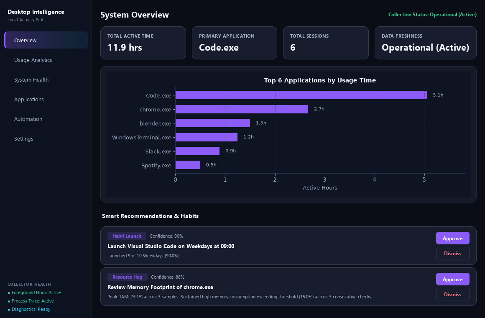

# Desktop Intelligence

Desktop Intelligence is a Windows desktop application for understanding local application usage, resource patterns, and selected system reliability events. It collects activity on the device, summarizes it in a PySide6 dashboard, and can suggest optional scheduled application launches.

> **Privacy note:** This software observes activity on the computer where it runs. Review [Data collection and privacy](docs/data-and-privacy.md) before enabling monitoring or automation.



*Dashboard preview populated with synthetic example data; it is not a record of a user's activity.*

## Motivation

The project explores a local-first way to answer questions such as which applications receive the most active time, whether resource use is repeatedly high, and which installed applications have or have not been observed during monitoring. Recommendations are based on locally collected records rather than a remote account or service.

## Features

- Records foreground application changes and process starts using Windows event sources, with health indicators and a fallback path for process-start collection.
- Captures process and system resource samples on configured activity events.
- Builds bounded activity sessions and usage summaries, including time-of-day and day-of-week patterns.
- Discovers installed applications from Windows registration and Start Menu shortcuts.
- Reads selected Windows Application log reliability events, such as application crashes and hangs.
- Shows overview, usage, health, application inventory, automation, and settings pages with light and dark themes.
- Creates evidence-backed habit and resource recommendations that can be approved or dismissed.
- Supports optional scheduled application launches with off, prompt, automatic, and notify modes. Automation is off by default; rules can require approval and attempts are logged.
- Provides a deterministic demo mode with isolated temporary data.

## Architecture

```text
Windows event sources ─┐
Process/resource data ─┼─> Collectors ─> CSV storage ─> Analytics/recommendations
Application inventory ┘                                      │
                                                             v
                                                    PySide6 dashboard
                                                             │
                                             Optional approved automation
```

The code is organized by responsibility:

| Area | Responsibility |
| --- | --- |
| `collectors/` | Foreground and process events, resource snapshots, inventory, and system errors |
| `analytics/` | Session cleanup, usage patterns, resource analysis, and recommendations |
| `storage/` | Thread-safe CSV persistence |
| `automation/` | Rules, consent-aware scheduling, and application launching |
| `visualization/` | Matplotlib charts embedded in the interface |
| `ui/` | PySide6 window, pages, themes, and consent dialogs |
| `platform/` | Windows sign-in startup integration |

The design is event-driven for foreground and process changes. An idle heartbeat is also used to close out sessions. See [the implementation ledger](docs/v4_ledger.md) for details about implemented reliability work.

## Technology

- Python 3.11 or later (TOML parsing uses the Python standard library `tomllib`)
- PySide6 and Matplotlib
- NumPy and Pandas
- psutil
- WMI through the `wmi` package, with a fallback collector path
- pytest for the test suite

The packages in `requirements.txt` are currently unpinned. Installing them resolves versions available at install time; this repository does not yet provide a lock file.

## Installation

This is a source project for Windows; a packaged installer is not provided.

1. Install Python 3.11 or later and make sure `python` is available in PowerShell.
2. Clone this repository and change into its directory.
3. Create and activate a virtual environment, then install the dependencies:

   ```powershell
   py -3.11 -m venv .venv
   .\.venv\Scripts\Activate.ps1
   python -m pip install --upgrade pip
   python -m pip install -r requirements.txt
   ```

   If PowerShell blocks activation, call the environment's interpreter directly, for example `.\.venv\Scripts\python.exe -m pip install -r requirements.txt`.

The legacy bootstrapper is also available: `python main.py` checks for a `myenv` environment and interactively offers to create it and install the packages. The manual virtual-environment steps above make that setup explicit.

## Run

Run commands from the repository directory:

```powershell
python main.py
```

Useful modes:

| Command | Purpose |
| --- | --- |
| `python main.py --demo-mode` | Open the dashboard with deterministic sample records in isolated temporary storage |
| `python main.py --diagnostics` | Print platform, collector, path, and data diagnostics |
| `python main.py --collector-only` | Run collection without the dashboard; consent-dependent automation is skipped without an interactive consent channel |
| `python main.py --rescan-inventory` | Scan installed application sources again |
| `python main.py --config C:\path\to\config.toml` | Use a chosen configuration file |

The standalone `--consent-prompt` command is an internal helper used by the automation flow; it is not a general-purpose automation interface.

## Configuration

`config.toml` is the checked-in default template. On first run, the application copies it to the per-user application directory and uses that copy for settings. On Windows the default base directory is `%LOCALAPPDATA%\DesktopIntelligence`; on other platforms it falls back to `~/.desktop_intelligence`. The active configuration can be supplied with `--config`.

Important settings include:

- `[paths]`: optional custom `data_dir` and `log_dir`.
- `[collection]`: foreground/process collection, inventory and system event toggles, idle timeout, resource-snapshot triggers, and window-title collection (off by default).
- `[retention]`: retention periods for event, session, and resource records.
- `[patterns]` and `[resources]`: thresholds used by analytics and recommendations.
- `[automation]`: automation mode, rule approval, prompt timeout, and duplicate-instance handling. Automation defaults to off.
- `[ui]`: theme, accent color, tray icon, and start-minimized behavior.
- `[llm]`: currently disabled by default; raw event sharing defaults to false.

## Data collection and storage

Records are stored locally as UTF-8 CSV files under `%LOCALAPPDATA%\DesktopIntelligence\data` by default. The application can also create logs under the sibling `logs` directory. The filenames include `activity_events.csv`, `activity_sessions.csv`, `resource_samples.csv`, `application_inventory.csv`, `recommendations.csv`, and `automation_log.csv`.

Depending on configuration and Windows availability, records can include process names and IDs, event times, active/idle durations, resource readings, installed application names and executable paths, recommendation evidence, and selected crash/hang diagnostics. Timestamps are stored in UTC. See [Data collection and privacy](docs/data-and-privacy.md) for the detailed inventory and controls.

## Screenshots

The `screenshots/` directory contains dashboard captures made with synthetic sample data. They illustrate the interface only and should not be treated as real monitoring output. To capture a fresh set on a Windows desktop or with Qt's offscreen platform:

```powershell
python scripts/capture_screenshots.py --output-dir screenshots/generated
```

Use `--demo-mode` to capture the application's deterministic demo dataset, or `--theme dark` / `--theme light` to capture one theme.

## Testing

Install the dependencies, then run the unit and integration suites:

```powershell
python -m pytest -v tests/unit tests/integration
```

The separate `tests/live/` suite touches real Windows event sources and is intentionally not included in that command. It should only be run on a Windows machine when live collection is appropriate. Some tests require Qt widgets and use the offscreen Qt platform; the `gui` and `windows` markers describe tests with additional environment needs.

## Known limitations

- Activity collection and the dashboard's system integrations target Windows. On another platform, Windows-specific sources are unavailable and the project is not a supported monitoring setup.
- WMI access and Windows event sources can vary by machine, permissions, and system configuration; the application reports collector health and uses a fallback for process starts where possible.
- Application inventory is based on registry and Start Menu sources and may not include every portable or per-user application.
- There is no installer, automatic updater, dependency lock file, cloud synchronization, or supported external LLM integration in this repository.
- This project has a local automated test suite, but results can differ across Windows versions and machines. Live collection is not fully represented by non-Windows test runs.

## Potential roadmap

These are possible next steps, not promises or features already implemented:

- Publish a reproducible dependency lock and signed Windows package.
- Add a guided first-run privacy and storage setup.
- Expand automated Windows compatibility coverage and document tested OS versions.
- Evaluate additional local-only reports and export formats.

## License

This project is licensed under the MIT License. See [LICENSE](LICENSE). It permits use, copying, modification, distribution, sublicensing, and sale, provided the copyright and license notice are included with copies or substantial portions. The software is provided without warranty.
